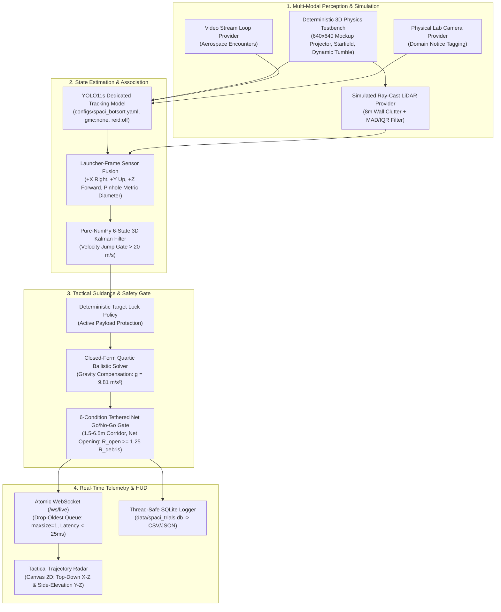

# SPACI 3.0: System Architecture & GNC Mathematical Foundation
## Space-Debris Detection, Tracking & Terrestrial Capture Demonstrator

---

### 1. Executive System Architecture

SPACI 3.0 bridges deep visual transfer learning with closed-loop aerospace Guidance, Navigation & Control (GNC). The software architecture is decoupled into five operational pipelines:

---

### 2. Coordinate Frame Conventions

All GNC and spatial projections are computed in the standard **Right-Handed Launcher Coordinate Frame ($\mathcal{F}_L$)**:
- **$+X_L$ Axis:** Points horizontally to the Right of the launcher aperture.
- **$+Y_L$ Axis:** Points vertically Upward against gravity ($\mathbf{g} = [0, -9.81, 0]^T\text{ m/s}^2$).
- **$+Z_L$ Axis:** Points Forward along the launcher optical boresight.

#### 2.1 Optical to Launcher Frame Mapping
For camera focal lengths $(f_x, f_y)$ and principal point $(c_x, c_y)$ with optical center coordinates $(u, v)$:
$$X_L = \frac{(u - c_x) \cdot Z_L}{f_x}$$
$$Y_L = -\frac{(v - c_y) \cdot Z_L}{f_y}$$
$$Z_L = Z_{\text{sensor}}$$

---

### 3. Non-Circular Ray-Cast LiDAR & MAD/IQR Filtering

To prevent circular depth dependency, depth is derived via ray-intersection against true 3D object geometry. Room clutter (e.g. walls at $Z \approx 8.0\text{ m}$) is rejected via a **Median Absolute Deviation (MAD)** and **Interquartile Range (IQR)** statistical filter:

$$\text{IQR} = Q_3 - Q_1$$
$$\text{Lower Gate} = Q_1 - 1.5 \cdot \text{IQR}, \quad \text{Upper Gate} = Q_3 + 1.5 \cdot \text{IQR}$$

Metric physical diameter is estimated strictly from bounding box pixel width $w$ and filtered depth $Z$:
$$D_{\text{est}} = \frac{w \cdot Z}{f_x}$$

---

### 4. Pure-NumPy 6-State 3D Kalman Filter

Implemented without external third-party dependencies (`filterpy`), the state vector $\mathbf{x} \in \mathbb{R}^6$ represents 3D position and velocity:
$$\mathbf{x} = \begin{bmatrix} X & Y & Z & \dot{X} & \dot{Y} & \dot{Z} \end{bmatrix}^T$$

#### 4.1 State Transition & Covariance Prediction
$$\mathbf{x}_{k|k-1} = \mathbf{F} \mathbf{x}_{k-1|k-1}, \quad \mathbf{P}_{k|k-1} = \mathbf{F} \mathbf{P}_{k-1|k-1} \mathbf{F}^T + \mathbf{Q}$$

where:
$$\mathbf{F} = \begin{bmatrix} \mathbf{I}_{3\times 3} & \Delta t \mathbf{I}_{3\times 3} \\ \mathbf{0}_{3\times 3} & \mathbf{I}_{3\times 3} \end{bmatrix}, \quad \mathbf{Q} = q \cdot \begin{bmatrix} \frac{\Delta t^3}{3}\mathbf{I}_3 & \frac{\Delta t^2}{2}\mathbf{I}_3 \\ \frac{\Delta t^2}{2}\mathbf{I}_3 & \Delta t \mathbf{I}_3 \end{bmatrix}$$

#### 4.2 Velocity Jump Gating
Measurements causing an instantaneous velocity change exceeding $20.0\text{ m/s}$ are rejected prior to covariance update:
$$\|\mathbf{v}_{\text{est}} - \mathbf{v}_{\text{prior}}\| > 20.0\text{ m/s} \implies \text{Reject Outlier}$$

---

### 5. Closed-Form Quartic Ballistic Intercept Solver

The net launcher fires a tethered projectile with muzzle velocity $v_{\text{net}} = 9.0\text{ m/s}$ under constant terrestrial gravity $\mathbf{g} = [0, -9.81, 0]^T\text{ m/s}^2$.

Given initial target position $\mathbf{P}_0 = [X_0, Y_0, Z_0]^T$ and estimated velocity $\mathbf{v}_t = [\dot{X}, \dot{Y}, \dot{Z}]^T$, the net and target meet at time $t$ if:
$$\left\| \mathbf{P}_0 + \mathbf{v}_t t - \frac{1}{2}\mathbf{g} t^2 \right\| = v_{\text{net}} t$$

Squaring both sides and grouping terms yields an exact 4th-degree polynomial:
$$c_4 t^4 + c_3 t^3 + c_2 t^2 + c_1 t + c_0 = 0$$

where:
- $c_4 = \frac{1}{4} \|\mathbf{g}\|^2 = \frac{1}{4} (9.81)^2 \approx 24.059$
- $c_3 = -\mathbf{v}_t \cdot \mathbf{g} = 9.81 \cdot \dot{Y}$
- $c_2 = \|\mathbf{v}_t\|^2 - \mathbf{P}_0 \cdot \mathbf{g} - v_{\text{net}}^2$
- $c_1 = 2 (\mathbf{P}_0 \cdot \mathbf{v}_t)$
- $c_0 = \|\mathbf{P}_0\|^2$

All roots are computed in closed form using pure-NumPy companion matrix eigenvalues (`np.roots`). The smallest real positive root $t_f > 0$ defines flight time.

#### 5.1 Aim Vector with Gravity Compensation
The launcher gimbal must aim along:
$$\mathbf{P}_{\text{aim}} = \mathbf{P}_0 + \mathbf{v}_t t_f - \frac{1}{2}\mathbf{g} t_f^2$$

Gimbal angles:
$$\text{Pan} = \arctan2(X_{\text{aim}}, Z_{\text{aim}}), \quad \text{Tilt} = \arctan2(Y_{\text{aim}}, \sqrt{X_{\text{aim}}^2 + Z_{\text{aim}}^2})$$

---

### 6. The 6-Condition Tethered Net Go/No-Go Safety Gate

Before launch authorization (`FIRE_READY`), all six safety criteria must evaluate to true:

| Condition # | Safety Criterion | Mathematical Threshold | Abort Code |
|---|---|---|---|
| **1** | Target Lock | Valid primary lock confirmed for $\ge 3$ consecutive frames | `ABORT_NO_LOCK` |
| **2** | Kinematic Stability | Kalman innovation residual $\|\mathbf{y}\| \le 0.50\text{ m/s}$ | `ABORT_UNSTABLE` |
| **3** | Ballistic Solvability | Real root $t_f \in \mathbb{R}^+, \; t_f > 0$ exists | `ABORT_UNREACHABLE` |
| **4** | Deployment Corridor | $1.5\text{ m} \le Z_{\text{int}} \le 6.5\text{ m}$ | `ABORT_OUT_OF_ENVELOPE` |
| **5** | Gimbal Limits | $|\text{Pan}| \le 75^\circ, \; -15^\circ \le \text{Tilt} \le +45^\circ$ | `ABORT_OUT_OF_ENVELOPE` |
| **6** | Net Aperture Ratio | $R_{\text{open}}(d_{\text{int}}) \ge 1.25 \cdot R_{\text{debris}}$ | `ABORT_NET_TOO_SMALL` |

---

### 7. 4-Corner Aerodynamic Net Opening Model

The expanding canopy radius $R_{\text{open}}$ as a function of travel distance $d$ follows a parabolic opening envelope:
$$R_{\text{open}}(d) = R_{\text{max}} \cdot \left[ 1 - \exp\left( -\frac{d}{d_{\text{char}}} \right) \right]$$

with nominal parameters:
- $R_{\text{max}} = 0.60\text{ m}$ (Maximum open radius)
- $d_{\text{char}} = 1.80\text{ m}$ (Characteristic expansion distance)
- Ferrous Assist: $+15\%$ effective margin applied when magnetic assist coils are energized on ferrous targets.
