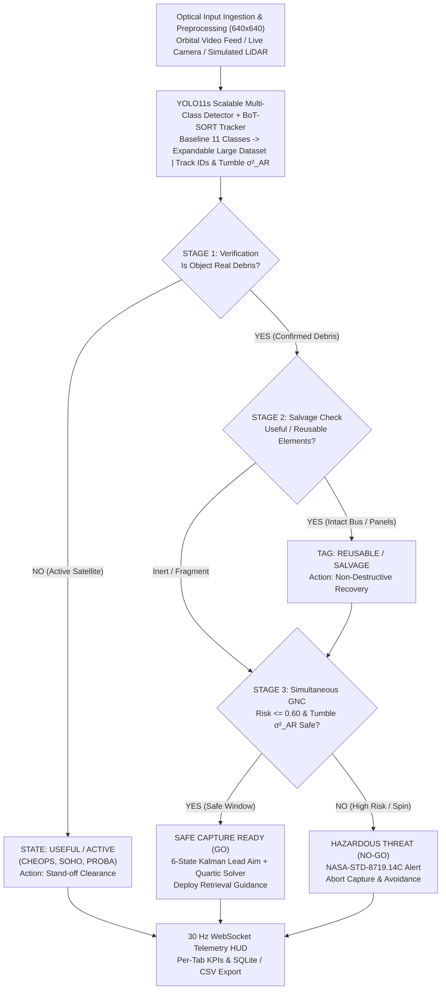
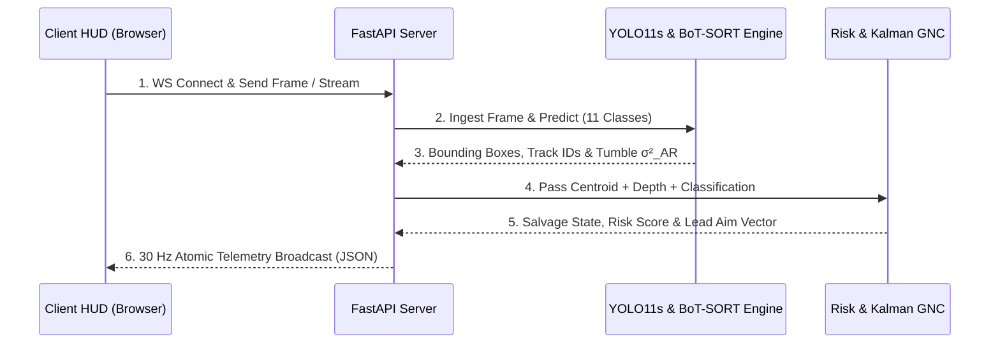

# SPACI Synopsis Diagram Blueprints & Editable Content Guide

All diagrams listed below are **already generated at 300 DPI and embedded automatically** inside [SPACI_OFFICIAL_SYNOPSIS_AISSMS.docx](file:///e:/Project_SPACI/reports/SPACI_OFFICIAL_SYNOPSIS_AISSMS.docx).  
If you ever want to redraw, customize, or restyle any diagram in **Draw.io (diagrams.net)**, **Mermaid Live Editor**, **Canva**, or **Lucidchart**, use the exact block labels, arrows, and code below.

---

## 1. Fig. 3.1: 3-Stage Autonomous Debris Decision Flowchart
**Embedded Asset:** `reports/figures/synopsis_decision_flowchart.png`  
**Use in:** Section 3 (Methodology)

### Mermaid Code (Paste at https://mermaid.live to edit/export SVG/PNG)

---

## 2. Fig. 4.1: Application & 5-Layer Software Architecture Block Diagram
**Embedded Asset:** `reports/figures/synopsis_block_diagram.png`  
**Use in:** Section 4 (Hardware / Software Design)

### Layer-by-Layer Draw.io Block Content
1. **Column 1 — Data & Sensor Input**
   - `Orbital Video Feeds (MP4 / AVI / WEBM)`
   - `Static Imagery & Multi-Batch Gallery`
   - `Live Camera / WebRTC Optical Stream`
   - `Simulated ToF LiDAR Range Sensor Feed`
2. **Column 2 — AI Detection & Tracking**
   - `Frame Normalizer (640x640 RGB Tensor)`
   - `YOLO11s Engine (Scalable Multi-Class Model)`
   - `BoT-SORT Tracker (Persistent Track IDs)`
   - `Tumble Estimator (15-Frame Variance σ²_AR)`
3. **Column 3 — Salvage & Risk Logic**
   - `Friend-or-Foe Filter (Debris vs Active Sat)`
   - `Salvage Classifier (Reusable Bus / Panels)`
   - `NASA-STD-8719.14C Kinetic Risk Scorer`
   - `4-State Flight Rules (Hazard / Active / Salvage / Inert)`
4. **Column 4 — 3D GNC & Safety Gate**
   - `MAD Outlier Rejector (2D + LiDAR 3D Fusion)`
   - `6-State Kalman Filter ([x, y, z, vx, vy, vz])`
   - `Quartic Lead Solver (Intercept Prediction)`
   - `6-Condition Interlock (GO / NO-GO Capture)`
5. **Column 5 — Mission Control HUD**
   - `FastAPI Async Core (REST Endpoints)`
   - `30 Hz WebSockets (Atomic Telemetry)`
   - `Interactive Web HUD (Three.js + Tab KPIs)`
   - `SQLite & CSV/JSON Mission Export`
- **Feedback Arrow (Bottom):** Dashed arrow from Column 5 back to Column 2/3 labeled: *"Operator Real-Time Threshold Tuning (Confidence, Risk Cutoff, Capture Range Envelope)"*.

---

## 3. Fig. 4.2: Data Flow Diagram (DFD Level 1)
**Embedded Asset:** `reports/figures/dfd_level1.png`  
**Use in:** Section 4 (Software Design)

```mermaid
flowchart LR
    P1(["1.0 Ingest & Preprocess"]) -- "Clean Frames" --> P2(["2.0 YOLO11s Inference"])
    P2 -- "Detections & Classes" --> P3(["3.0 BoT-SORT Tracking"])
    P3 -- "Tracked Centroids + LiDAR" --> P4(["4.0 3D Fusion & Kalman"])
    P4 -- "3D State Vectors" --> P5(["5.0 NASA Risk & Salvage Engine"])
    P5 -- "Risk Score + Operational State" --> P6(["6.0 30 Hz Telemetry Streaming"])
```

---

## 4. Fig. 4.3: UML Sequence Diagram
**Embedded Asset:** `reports/figures/uml_sequence.png`  
**Use in:** Section 4 (Interfacing & Communication Details)

